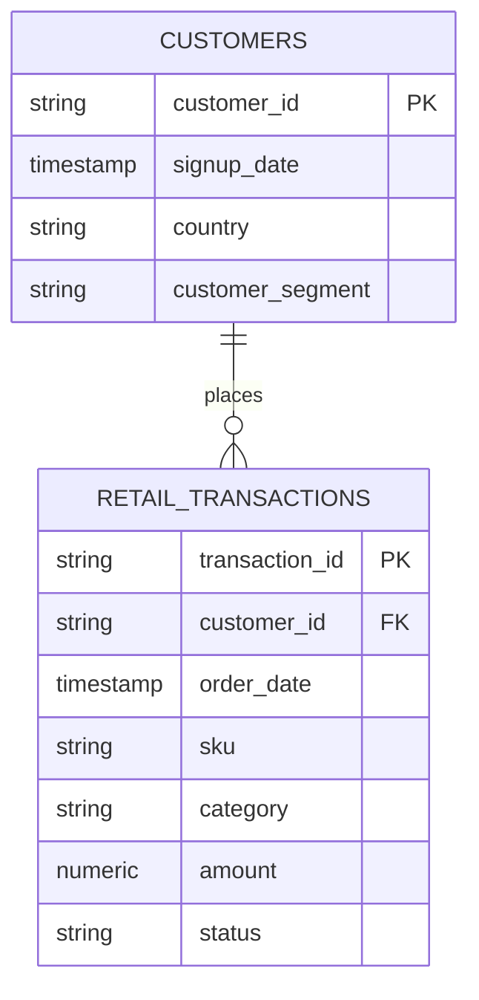

# 🛒 Customer Cohort & Retention Analytics Pipeline (PostgreSQL)

[](https://www.postgresql.org/)
[](https://github.com/Jeet908)

An enterprise-grade SQL analytics pipeline engineered to evaluate 30-day customer retention cohorts, churn velocity, and repeat purchase intervals across 100k+ multi-table transactional records.

---

## 📌 Executive Summary
Customer acquisition costs (CAC) continue to rise across retail and e-commerce. This pipeline provides business intelligence into:
1. **Month-over-Month Cohort Retention:** Quantifying the decay rate of new customers over a 12-month horizon.
2. **Repurchase Frequency & Days-to-Second-Purchase:** Pinpointing the exact 30-day window where churn intervention is most profitable.
3. **Customer Tier Lifetime Value (LTV):** Segmenting high-frequency repeat buyers from one-and-done purchasers.

---

## 🏗️ Architecture & Data Model



---

## 🛠️ Advanced SQL Techniques Demonstrated
- **Common Table Expressions (CTEs):** Multi-layered modular queries isolating cohort origin dates, customer transaction indices, and total cohort pool sizing.
- **Window Functions:**
  - `ROW_NUMBER() OVER(PARTITION BY customer_id ORDER BY order_date ASC)` to sequence lifetime order frequency.
  - `LAG(order_date, 1) OVER(...)` to calculate transaction recency and inter-purchase interval in days.
- **Date Truncation & Interval Math:** Dynamic monthly grouping using `DATE_TRUNC('month', order_date)` and cross-year mathematical index calculations.

---

## 📊 Sample Cohort Retention Output

| Cohort Month | Cohort Size | Month 0 | Month 1 | Month 2 | Month 3 | Month 4 |
| :--- | :--- | :--- | :--- | :--- | :--- | :--- |
| **Jan 2023** | 1,240 | 100.0% | 28.4% | 21.1% | 18.2% | 15.6% |
| **Feb 2023** | 1,110 | 100.0% | 26.9% | 19.8% | 17.0% | 14.1% |
| **Mar 2023** | 1,450 | 100.0% | 31.2% | 23.4% | 19.5% | 16.8% |

### Key Business Insights:
- The sharpest churn cliff occurs between **Month 0 and Month 1** (~71% drop-off).
- Customers who execute a second purchase within **18 days** exhibit a **3.4x higher 12-month retention rate** than those with repurchases past day 30.

---

## 🚀 How to Run Locally

### 1. Clone the repository
```bash
git clone https://github.com/Jeet908/customer-cohort-retention-sql.git
cd customer-cohort-retention-sql
```

### 2. Run in your PostgreSQL client (pgAdmin, DBeaver, or psql)
```bash
psql -U postgres -d postgres -f sql/01_schema.sql
# Generate and load synthetic data
python data/generate_sample_data.py
psql -U postgres -d postgres -c "\copy retail_transactions FROM 'transactions.csv' WITH (FORMAT csv, HEADER true);"
# Execute Analytics
psql -U postgres -d postgres -f sql/02_cohort_retention.sql
psql -U postgres -d postgres -f sql/03_repeat_purchase_metrics.sql
```

---

## 👤 Author
**Sourojit Kar**  
- [GitHub Profile](https://github.com/Jeet908)
- [LinkedIn Profile](https://linkedin.com/in/sourojitkar)
